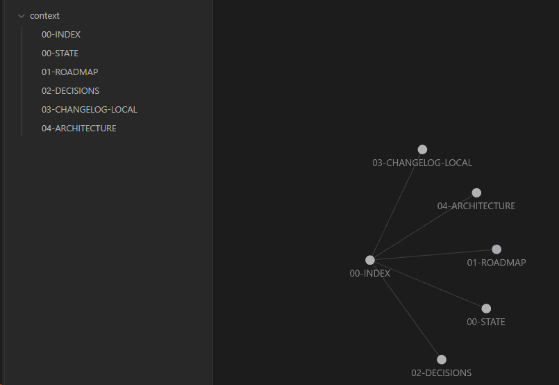

# 🌌 SecDevOps Antigravity — 2-Tier Low-Token Agent Architecture & Galaxy Mind Radar

<p align="center">
  
</p>

<p align="center">
  <strong>2-Tier Agent Architecture (-67.4% Customization Overhead • -35.1% Step #1 Input Tokens • -30.4% Multi-Step Task Budget) • Real-Time Galaxy Mind &amp; Token Radar (PiP)</strong>
</p>

---

## 🚀 Overview

**SecDevOps Antigravity** is a full-stack Software Engineering, Security (SecOps/OSINT), Networking/Homelab, System Architecture, TDD, and Context Governance ecosystem built natively for **Google Antigravity (AGY)**.

Instead of injecting all 82 skills and 30 subagents into the system prompt on every turn (which wastes thousands of tokens per message), this repository implements a **4-Ring Orbital Architecture (2 Tiers)** powered by **Mandatory Step #1 Auto-Triggers**:

| Orbital Ring | Tier | Count | How It Works |
| :--- | :--- | :--- | :--- |
| **🟣 Ring 1** | Preloaded (`.agents/agents/`) | **11 Core Agents** | Always ready in session (`planner`, `architect`, `tdd-guide`, `code-reviewer`, `security-reviewer`, `database-reviewer`, `python-reviewer`, `network-config-reviewer`, `network-troubleshooter`, `build-error-resolver`, `code-explorer`) |
| **🔵 Ring 2** | Preloaded (`.agents/skills/`) | **15 Core Skills** | High-frequency skills (`verification-loop`, `security-review`, `git-workflow`, `docker-patterns`, `deployment-patterns`, `network-config-validation`, `unified-memory`, `strategic-compact`, etc.) |
| **🩷 Ring 3** | On-Demand (`agents/`) | **19 Specialist Agents** | Specialized language and domain subagents loaded when needed |
| **🟡 Ring 4** | On-Demand (`skills/`) | **67 Specialist Skills** | Automatically loaded via `read_file` on **Step #1** through the index in `common-secdevops-router.md` only when the prompt touches that domain |

---

## ⚡ Mandatory Auto-Triggers & Delivery Gate (`common-secdevops-router.md`)

Thanks to **Section 4 (`Mandatory Auto-Triggers & Delivery Gate`)** in `.agents/rules/common-secdevops-router.md`, you **never need to remember or type any skill or subagent name**:

1. **Step #1 Auto-Skill Trigger:** Whenever a prompt touches any domain covered by the catalog (Networking, VLANs, Cisco IOS, WireGuard, Pi-hole, Kubernetes, PostgreSQL, Redis, Security, OSINT, etc.), the agent automatically calls `read_file` on the matching `SKILL.md` files on its very first step.
2. **Post-Code Automated Delivery Gate:** After creating or modifying any code, script, or UI file, the agent is strictly required to:
   - Run the automated test suite (`node --test` / `pytest` / `go test`) and verify a 100% pass rate;
   - Automatically invoke the `code-reviewer` subagent (plus `security-reviewer` / `network-config-reviewer` when applicable);
   - Verify any local daemon server (`IsDaemon: true`) with a live HTTP health check.

---

## 📊 Empirical Token Benchmark (100% Live-Measured in `transcript.jsonl`)

Instead of relying on theoretical estimates or composite sums, we ran **controlled multi-run ($N = 3$) end-to-end benchmarks** directly inside Google Antigravity, comparing **Scenario A (Monolithic — all 82 skills, 30 subagents, and 19 rules injected into the active prompt)** against **Scenario B (Our 2-Tier Orbital Architecture — 15 preloaded skills, 11 core agents, `trigger: glob` language rules, and `common-secdevops-router.md`)** and reading the exact token counters recorded by the runtime in `.system_generated/logs/transcript.jsonl`.

> **Reproducibility note:** these measurements were captured from local Antigravity runtime transcripts (`.system_generated/logs/transcript.jsonl`), which are **not distributed with this repository**. The run IDs document provenance, but third parties must collect their own transcripts to reproduce the numbers.

### 1. Per-Turn System Prompt Overhead (Live-Measured Step #1 Breakdown)

| Injected Layer per Turn | 🔴 Scenario A (Monolithic Measured) | 🟢 Scenario B (2-Tier Measured) | 💰 Exact Measured Savings |
| :--- | :---: | :---: | :---: |
| **1. Antigravity Base Prompt** *(Native IDE + Tools + Task)* | `11,082 tokens` | `11,082 tokens` | *Fixed IDE & prompt baseline* |
| **2. Active Customization Payload** *(82 Skills + 30 Agents + Rules)* | **`12,061 tokens/turn`** | **`3,931 tokens/turn`** | **`-8,130 tokens/turn` (`-67.4%`)** |
| **📈 Total Step #1 Prompt Tokens (`input_tokens`)** | **`23,143 tokens`** *(mean, $N=3$)* | **`15,013 tokens`** *(mean, $N=3$)* | **`-8,130 tokens/call` (`-35.1%`)** |

### 2. End-to-End Completed Task Benchmark ($N = 3$ Multi-Step Runs per Scenario)

To measure the **real budget per completed task** (including the cost of `read_file` loading `homelab-vlan-segmentation` and `cisco-ios-patterns` on Step #1 and generating the complete hardened Cisco IOS VLAN/ACL/DHCP-Snooping/Port-Security configuration on Step #2):

| Scenario & Run ID (`transcript.jsonl`) | Step #1 Prompt (`input + cache`) | Step #2 Prompt (`after 2x read_file`) | Cumulative Task Prompt Tokens | Uncached New `input_tokens` | Output Tokens |
| :--- | :---: | :---: | :---: | :---: | :---: |
| 🟢 **Scenario B — Run 1 (`f6018ce4`)** | `15,016` | `22,001` *(+6,984 skill fetch)* | `37,017` | `22,000` | `1,532` |
| 🟢 **Scenario B — Run 2 (`c5f3e20f`)** | `15,012` | `22,157` *(+7,144 skill fetch)* | `37,169` | `22,156` | `2,631` |
| 🟢 **Scenario B — Run 3 (`cddd7aad`)** | `15,012` | `22,014` *(+7,001 skill fetch)* | `37,026` | `22,013` | `2,118` |
| **🟢 Scenario B Mean ($N = 3$)** | **`15,013 tokens`** | **`22,057 tokens`** | **`37,071 tokens`** | **`22,056 tokens`** | **`2,094 tokens`** |
| 🔴 **Scenario A — Run 1 (`5363df44`)** | `23,145` | `30,090` *(+6,944 skill fetch)* | `53,235` | `30,089` | `1,918` |
| 🔴 **Scenario A — Run 2 (`2892b0ae`)** | `23,141` | `30,161` *(+7,019 skill fetch)* | `53,302` | `30,160` | `2,740` |
| 🔴 **Scenario A — Run 3 (`90c67441`)** | `23,143` | `30,152` *(+7,009 skill fetch)* | `53,295` | `11,113` *(warm cache)* | `2,907` |
| **🔴 Scenario A Mean ($N = 3$)** | **`23,143 tokens`** | **`30,134 tokens`** | **`53,277 tokens`** | **`30,125 tokens` *(cold)*** | **`2,522 tokens`** |
| **💰 Exact Multi-Step Task Savings (B vs. A)** | **`-8,130` (`-35.1%`)** | **`-8,077` (`-26.8%`)** | **`-16,206 tokens` (`-30.4%`)** | **`-8,069 tokens` (`-26.8%`)** | — |

### 3. Single-Step Monolithic ($N = 3$) vs. Multi-Step On-Demand Trade-off

What if Scenario A answers in **1 single step** without calling `read_file` (`c101b2fb`: `23,125 tokens`, `25abaf2b`: `23,124 tokens`, mean **`23,125 tokens`**), while Scenario B spends **2 steps** to fetch the 2 domain skills via `read_file`?
- **Cold Uncached `input_tokens` Billed:** Scenario B (`2 steps`, **`22,056 new input_tokens`**) still bills **`1,069 fewer new input_tokens` (`-4.6%`)** than a 1-step Monolithic call (**`23,125 new input_tokens`**), because Step #2 in Scenario B hits the Gemini prompt cache (`15,014 cache_read_tokens`, `68%` cache hit) and only bills `+7,043` new tokens for the two `SKILL.md` files!
- **Multi-Turn Scaling:** From Turn 2 onward, every additional step (testing, `code-reviewer`, git workflow) saves **`8,130 prompt tokens` per turn** in Scenario B (`~243,900 tokens` saved over a 30-turn engineering session).

> **Key Engineering Takeaways:**
> - **Preloaded vs. Catalog Disk Payload:** Preloaded `.agents/` drops from **`1,365 KB` (`82 skills / 30 agents`)** down to **`262 KB` (`-80.8%` disk footprint)**.
> - **Zero-Cost Workflows:** Custom slash workflows in `.agents/workflows/` (`0 tokens/turn`) stay dormant on disk until explicitly invoked via `/monitor` or `/command`.
> - **Surgical On-Demand Loading:** Fetching 2 specialist skills via `read_file` adds **`~7,043 tokens` once**, which is still smaller than the **`8,130 tokens/turn`** tax of keeping all 82 skills and 30 agents permanently in the system prompt.

---

## 🛰️ Antigravity Galaxy Mind & Token Radar (`token-monitor/`)

This repository includes the **Antigravity Galaxy Mind & Token Radar** (`token-monitor/`), a real-time visual telemetry server (`http://127.0.0.1:4317`) with native **Document Picture-in-Picture (PiP)** support:

- **Interactive 4-Ring Galaxy Orbit & Node Inspector:** Watch in real time which Skills (Rings 2 & 4) and Subagents (Rings 1 & 3) are connected to the `AGY CORE` nucleus — and **click any orbiting sphere (or chip)** to open an interactive summary card explaining what that skill or subagent does (`PT-BR` & `EN`).
- **Smart Session Selector + `🔄 Refresh Chats` Button:** Automatically distinguishes **Main Chats (`🟢`)** and **Subagents (`🤖`)**, displaying the human-readable conversation topic and step count.
- **Sliding Token Usage per Step Chart:** Follows your inspected step (`⏮ Prev` / `⏭ Next`), displaying the new tokens spent per step (`+In/Out`), the action icon (`⚡` Skill, `🤖` Subagent, `💻` Terminal, `📄` Read, `✏️` Edit), and the **Cache Hit Rate**.
- **Instant Filters:** Toggle between `EN` / `PT-BR` and `Show On-Demand: ON (4 Rings) / OFF (Preloaded Only)`.
- **Always-on-Top Corner HUD (`📌 Corner Popup / PiP`):** Compact floating window with self-contained dark styling so you can monitor active beams and token usage while coding.

### Slash Workflow Commands (`/monitor`)

```text
/monitor start    # Starts the background daemon server and opens http://127.0.0.1:4317
/monitor popup    # Opens directly in compact Corner Popup mode
/monitor status   # Prints live token and cache telemetry in chat
/monitor stop     # Stops the local monitor server on port 4317
```

Or via terminal:

```bash
node token-monitor/src/cli.js start
node --test token-monitor/test/*.test.js
```

---

## 🧠 Local Context Gate & Obsidian Graph (`context/`)

Architectural decisions, verified state, and roadmaps are maintained in `context/`, structured for **Obsidian Graph View**:

<p align="center">
  
</p>

- **`context/00-INDEX.md`** — Central hub linking all governance documents.
- **`context/00-STATE.md`** — Verified current state, environment isolation, and workflow rules.
- **`context/01-ROADMAP.md`** — Validation checklist and continuous roadmap.
- **`context/02-DECISIONS.md`** — Architecture Decision Records (ADRs).
- **`context/03-CHANGELOG-LOCAL.md`** — Chronological log of 100% tested and verified deliverables.
- **`context/04-ARCHITECTURE.md`** — Complete directory and two-tier architecture map.

---

## 📂 Repository Structure

```text
secdevops-antigravity/
├── .agents/                  # Preloaded 2-Tier Profile (15 skills, 11 agents, 7 workflows incl. /monitor, 20 rules)
├── token-monitor/            # Official Galaxy Mind & Token Radar (127.0.0.1:4317 + 24 automated unit/UI/security tests)
├── context/                  # Architectural Context Ledger compatible with Obsidian Graph View
├── agents/                   # Full catalog of 30 specialized subagent definitions
├── skills/                   # Full catalog of 82 skills (SecDevOps, Homelab, Cloud, Backend, OSINT, TDD)
├── commands/                 # 87 slash workflows and commands (including /monitor)
├── contexts/                 # 4 operational posture modes (dev.md, review.md, research.md, secops.md)
├── rules/                    # Modular rule packs (common, python, typescript, golang)
├── scripts/                  # Multi-target installer, doctor.js, repair.js, and memory utilities
└── manifests/                # Installer module and profile manifests
```

---

## 🛠️ Quick Start

1. **Zero-Config Workspace Usage:**
   Clone this repository and open it in **Google Antigravity**. Because `.agents/` is pre-configured at the root, all **15 preloaded skills**, **11 agents**, **7 workflows (`/monitor`)**, **20 rules**, and the **on-demand router for all 67 specialist skills** are active out of the box!
2. **Health Diagnostics (`doctor.js`):**
   ```bash
   node scripts/doctor.js --target antigravity
   ```
3. **Run the Token Monitor Test Suite:**
   ```bash
   node --test token-monitor/test/*.test.js
   ```
4. **Bootstrap dependencies (installer only):**
   `doctor.js` and the token-monitor test suite run **without** external dependencies. The installer (`scripts/install-apply.js`) imports `js-yaml`/`ajv`, so on a fresh clone run `npm install` first — or use `install.ps1`/`install.sh`, which install dependencies automatically. Requires Node >= 18.
   ```bash
   npm install
   ```
   No pre-defined absolute path is required: all tooling resolves relative to the repository root, with optional overrides via `AGY_PRELOADED_ROOT`, `AGY_CATALOG_ROOT`, `AGY_MONITOR_PORT`, `AGY_MONITOR_DIR`, `AGY_MEMORY_VAULT`, and `AGY_NODE_BIN`.

---

## 📄 License

Distributed under the **MIT License**. See [LICENSE](./LICENSE) for details.
